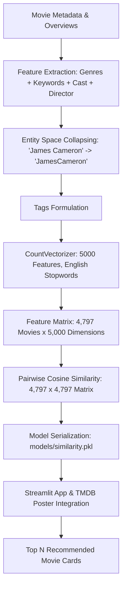

# 🎬 Netflix Movie Recommendation System

[](https://www.python.org/)
[](https://streamlit.io/)
[](https://scikit-learn.org/)
[]()

A modern, fast, and responsive **Content-Based Movie Recommendation System** built with Python and Streamlit, featuring a Netflix-inspired dark UI. Powered by Natural Language Processing (NLP), Bag-of-Words tokenization (`CountVectorizer`), and vector angle evaluation (`Cosine Similarity`).

---

## 📌 Features

- **Personalized Recommendations:** Computes top recommendations using pairwise cosine similarity across plot overviews, genres, directors, cast members, and keywords.
- **Netflix Dark Theme:** Custom CSS interface replicating Netflix's sleek dark theme and responsive layout.
- **Real-Time Poster Fetching:** Integrated with TMDB API to dynamically fetch official movie posters, with a graceful offline fallback placeholder.
- **Fast & Lightweight:** Optimized model storage using half-precision (`float16`) similarity matrices for rapid load times (<5ms lookup) and minimal disk footprint.
- **Interactive Search:** Auto-complete search across 4,797 movie titles with adjustable recommendation counts (5–10).

---

## 🛠️ Technology Stack

| Technology | Purpose |
| :--- | :--- |
| **Python 3** | Core programming language |
| **Pandas & NumPy** | Data manipulation, feature engineering, and matrix operations |
| **Scikit-Learn** | NLP text vectorization (`CountVectorizer`) and `cosine_similarity` |
| **Streamlit** | Interactive Netflix-themed dark web application UI |
| **TMDB API** | Dynamic retrieval of high-resolution movie posters |
| **Pickle** | High-speed model artifact serialization |

---

## 📂 Project Directory Structure

```text
Netflix-Recommendation-System/
├── app.py                      # Streamlit web application frontend
├── recommend.py                # Recommender engine & TMDB poster retrieval
├── train_model.py              # Model training utility runner
├── requirements.txt            # Python dependencies
├── README.md                   # Project documentation
│
├── data/
│   └── movies.csv              # Cleaned movie metadata & tags dataset (4,797 movies)
│
├── models/
│   ├── movie_list.pkl          # Serialized movie metadata DataFrame
│   └── similarity.pkl          # Serialized pairwise similarity matrix (float16)
│
├── assets/
│   └── default_poster.png      # Offline fallback Netflix poster placeholder
│
└── .streamlit/
    └── config.toml             # Streamlit Netflix dark theme configuration
```

---

## 🧠 Machine Learning Methodology



### 1. CountVectorizer (Bag of Words)
Each movie's combined textual description (`tags`) is converted into a numerical vector using `sklearn.feature_extraction.text.CountVectorizer`:
* **`max_features=5000`:** Retains the 5,000 most frequent informational words across the entire movie corpus.
* **`stop_words='english'`:** Automatically filters uninformative filler words (*the, is, and, at, which*).
* **Output:** A dense numerical matrix of dimensions $(4797, 5000)$.

### 2. Cosine Similarity Calculation
Rather than Euclidean distance (which is biased by the length of a movie's synopsis), **Cosine Similarity** evaluates the directional angle $\theta$ between two vectors in multi-dimensional space:

$$\text{Cosine Similarity}(A, B) = \cos(\theta) = \frac{A \cdot B}{\|A\| \|B\|} = \frac{\sum_{i=1}^{n} A_i B_i}{\sqrt{\sum_{i=1}^{n} A_i^2} \sqrt{\sum_{i=1}^{n} B_i^2}}$$

* $\cos(0^\circ) = 1.0$: Identical match (100%).
* $\cos(90^\circ) = 0.0$: Orthogonal, zero shared features.

---

## 🚀 Installation & How to Run

### Step 1: Clone the Repository
```bash
git clone https://github.com/singhrajvardhan48/Netflix-Recommendation-System.git
cd Netflix-Recommendation-System
```

### Step 2: Install Dependencies
```bash
pip install -r requirements.txt
```

### Step 3: (Optional) Retrain or Re-generate Models
The repository includes pre-built model artifacts in `models/`. To retrain from `data/movies.csv`:
```bash
python train_model.py
```

### Step 4: Run the Streamlit Application
```bash
streamlit run app.py
```

Open your browser and navigate to `http://localhost:8501`.
